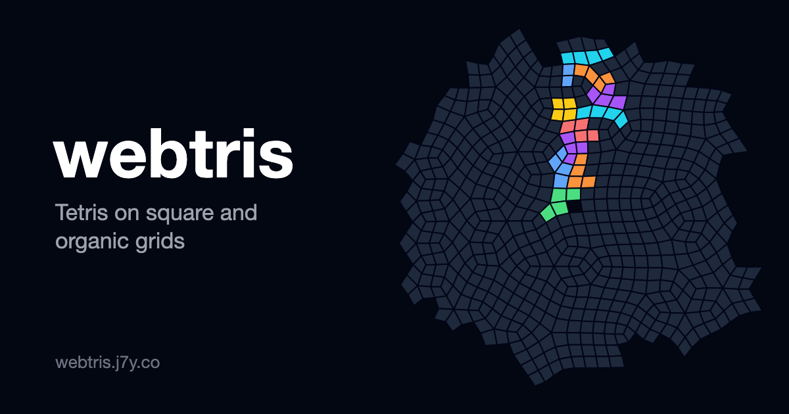

# webtris

Tetris in the browser on three grids. Play it at https://webtris.j7y.co.



## Modes

| Mode | Grid | A line is |
|---|---|---|
| Classic | 10 × 20 squares | a full row |
| Organic well | irregular quads, gravity down | a horizontal band one cell high |
| Organic disc | irregular quads, gravity to the centre | a ring around the centre |

The organic grids use the irregular quad-grid technique shared by Oskar Stålberg:
a triangle lattice, triangles paired into quads, every quad split into four, then
relaxed toward squares. Pieces bend to fit the cells they cross.

Rules on the irregular grids:

- Down always moves a piece to a lower cell, at most 45° off straight down
  (60° only where nothing steeper exists).
- Nothing floats: a piece that stops with no block resting on anything drops
  block by block until each block rests.
- Disc rings are closed loops of cells joined edge to edge.

## Controls

| Key | Action |
|---|---|
| ← → | steer |
| ↑ or X | rotate |
| Z | rotate back |
| ↓ | soft drop |
| Space | hard drop |
| P or Esc | pause |

## Stack

- [PixiJS](https://pixijs.com/) v8 draws the board.
- [anime.js](https://animejs.com/) v4 runs the effects (drops, clears, score).
- [Tailwind CSS](https://tailwindcss.com/) v4 and Tailwind Plus Elements for the menus and HUD.
- Vite builds it, Vitest tests it.
- Cloudflare Workers serves the static build (no Worker script).

## Development

Requires Node 24 or later.

```bash
npm install
npm run dev       # dev server on http://localhost:5173
npm test          # Vitest
npm run build     # type check + build to dist/
npm run preview   # build, then serve dist/ with wrangler dev
```

## Layout

| Path | Contents |
|---|---|
| `src/grid.ts` | board generators: square, organic well, organic disc |
| `src/game.ts` | rules: pieces, moves, rotation, locking, line clears, scoring |
| `src/render.ts` | PixiJS drawing and anime.js effects |
| `src/main.ts` | game loop, keyboard input, HUD |
| `src/game.test.ts` | tests |
| `index.html` | page shell, dialogs, meta tags |
| `public/og.png` | share image (1200 × 630) |

## Deployment

Every push to `main` runs CI (`.github/workflows/ci.yml`): tests and build, a
[zizmor](https://docs.zizmor.sh/) audit of the workflows, then `npm run deploy`
to Cloudflare. The Worker serves `dist/` at the custom domain `webtris.j7y.co`.

The `production` environment needs two secrets:

- `CLOUDFLARE_ACCOUNT_ID`
- `CLOUDFLARE_API_TOKEN`: an account-owned token with **Workers → Editor** on the
  whole account and **Zone → Workers Routes → Write** on `j7y.co`. A token scoped
  to the single Worker is not enough, because custom domains do not support
  per-Worker permissions yet.

To deploy by hand: `npx wrangler login`, then `npm run deploy`.
